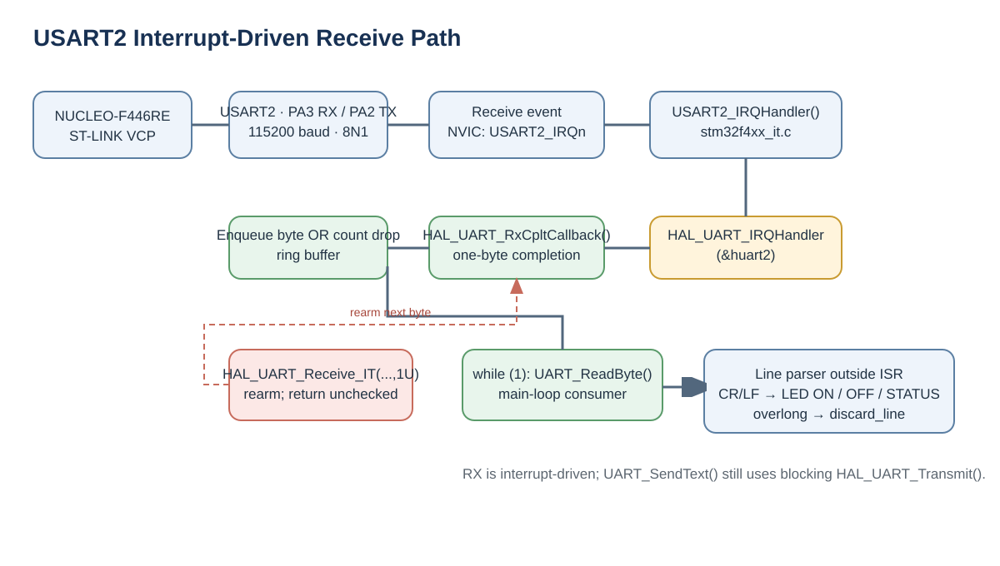
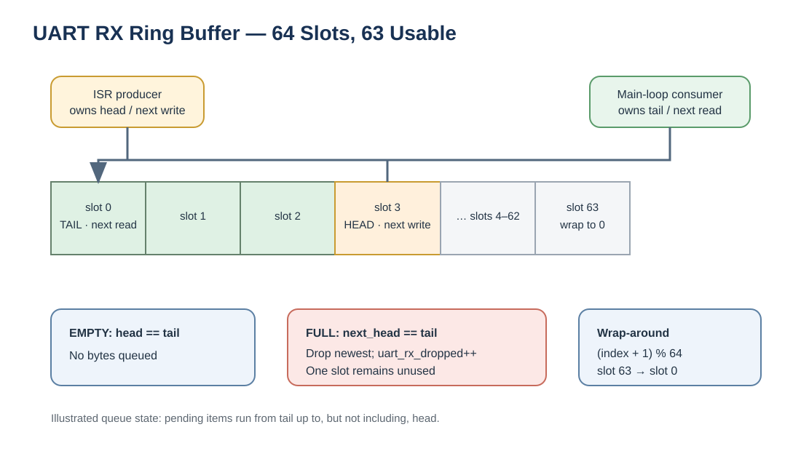

# STM32F446 Signal Lab

An embedded systems project focused on signal generation, data acquisition, and digital signal processing (DSP) using the STM32F446RE microcontroller.

This project aims to develop a signal generetaion and analysis platform, integrating low-level peripherial configuration, real-time data acquisition, serial communication, and PC-based visualization.

## Hardware & Tools

- Board: STMicroelectronics NUCLEO-F446RE
- MCU: STM32F446RET6 (ARM Cortex-M4, 180 MHz)
- Development Environment: Visual Studio Code with STM32CubeIDE for VS Code extension
- MCU Configuration: STM32CubeMX
- Firmware Libraries: STM32 HAL and BSP
- Compiler: GNU Arm Embedded GCC
- Build System: CMake + Ninja
- Programming & Debugging: ST-LINK/V2-1, GDB, STM32CubeProgrammer
- Version Control: Git & GitHub

## Phase 0 — Development Environment & GPIO (Completed)

The objective of this initial phase was to set up and validate the development environment for the STM32F446RE microcontroller.

STM32CubeMX was used to configure the microcontroller peripherals and generate the initial firmware structure, while Visual Studio Code was selected as the primary development environment due to my previous experience and familiarity with the editor.

The development workflow was established using CMake and the GNU Arm toolchain for compilation, alongside the onboard ST-LINK debugger for firmware flashing and debugging.

Once the environment was configured, a simple LED blinking application was implemented to verify the complete development workflow. The application toggles the onboard LED every 500 ms using the STM32 HAL and BSP libraries.

## Phase 1 — UART Communication & Command Interface (Planned)

### Objective

The objective of this phase is to establish bidirectional UART communication between the STM32F446RE microcontroller and a PC, and then develop a command-line interface to control the board.
The implementation is divided into five stages:
1. UART transmission using polling.
2. UART reception using polling and an echo application.
3. Serial command parsing and GPIO control.
4. Interrupt-driven UART reception using a circular buffer.
5. UART error handling and communication validation (pending).
The final objective is to develop a reliable serial communication interface that can be extended in subsequent phases to configure signal generation, data acquisition, and other peripherals.

### Implementation

1.1 — **UART Transmission (Polling)**

The first step was to configure USART2 using STM32CubeMX, with a baud rate of 115200 bps, a word length of 8 bits and no parity bit. 

The NUCLEO-F446RE includes an onboard ST-LINK debugger with a Virtual COM Port interface. Through this interface, the PC can exchange UART data with the microcontroller through the same USB cable used to programming and debugging.

This first implementation uses a blocking approach: the CPU waits for the UART hardware to become available, writes each byte to the USART data register (DR), and waits until the transmission is completed.

1.2 — **UART Reception (Polling)**

Once transmission was working, I implemented UART reception using HAL_UART_Receive().

This function waits for incoming data and stores it in a variable provided through a pointer.

I developed a simple UART Echo application: whenever the STM32 received a character from the PC, it immediately transmitted the same character back.

For example, sending A from the serial terminal resulted in receiving A back.

However, polling-based reception has an important limitation: the CPU remains blocked while waiting for data or until the configured timeout expires.

1.3 — **UART Command Parser**

The next step was to replace the echo application with a simple command-line interface.

The implementation receives characters individually and stores them in a command buffer until a line-ending character (\r or \n) is detected.

When a complete command is received, a null terminator (\0) is appended and the command is compared against predefined strings using strcmp().

The following commands were implemented:

- LED ON: Turns the onboard LED on
- LED OFF: Turns the onboard LED off
- STATUS: Returns the current LED state
- Unknown command: Returns an error message

A 32-byte command buffer was used, allowing a maximum of 31 characters plus the null terminator.

To prevent buffer overflows, a discard_line flag was introduced. When the command exceeds the buffer capacity, incoming characters are discarded until the next line-ending character is received.

1.4 — **Interrupt-Driven UART Reception**

### Motivation: Polling vs. Interrupts

Polling with \`HAL_UART_Receive()\` kept the CPU waiting for a byte or timeout, preventing the main loop from doing other work. Interrupt reception lets the main loop continue until USART2 signals a received byte, then briefly suspends it to service that event. Reception is asynchronous, but the application is not fully non-blocking: \`HAL_UART_Transmit()\` still blocks.

### Hardware-to-application interrupt path

USART2 is configured at 115200 baud, 8 data bits, no parity, one stop bit (8N1). PA2 is TX and PA3 is RX; the NUCLEO-F446RE routes these through the ST-LINK Virtual COM Port. HAL MSP initialization enables the USART2 clock, configures alternate function 7, sets interrupt priority, and enables \`USART2_IRQn\` in the NVIC.

\`\`\`text
USART2 receives a byte
  → NVIC dispatches USART2_IRQn
  → USART2_IRQHandler() in stm32f4xx_it.c
  → HAL_UART_IRQHandler(&huart2)
  → HAL_UART_RxCpltCallback(&huart2) in main.c
  → enqueue byte and rearm one-byte receive
  → return to the interrupted main-loop instruction
\`\`\`

### Initial receive and rearm

After peripheral and application initialization, \`main()\` arms the first receive:

\`\`\`c
HAL_UART_Receive_IT(&huart2, &uart_rx_it_byte, 1U);
\`\`\`

HAL records the destination and length, then enables the receive interrupt. Once one byte arrives, HAL places it in \`uart_rx_it_byte\` and calls \`HAL_UART_RxCpltCallback()\`. The callback transfers it into the software queue and calls \`HAL_UART_Receive_IT()\` again. Because the configured length is one byte, each completion must be rearmed to receive the next byte; this is not a permanent stream registration.

The initial call is checked and enters \`Error_Handler()\` if it fails. The callback ignores the return value of its rearm call, so a failure there can stop reception without recovery.

### Ring buffer: ISR producer and main-loop consumer

The queue is \`uart_rx_buffer[64]\`. One slot is reserved to distinguish full from empty, leaving 63 usable pending bytes. The receive callback (producer) alone advances \`uart_rx_head\`, the next write position. \`UART_ReadByte()\` in the main loop (consumer) alone advances \`uart_rx_tail\`, the next read position.

For each received byte, the callback computes the candidate next head. If it equals tail, the queue is full: the new byte is dropped and \`uart_rx_dropped\` increments. Otherwise, the byte is written at the current head and then head advances. Both indices wrap modulo 64.

\`\`\`c
uint8_t next_head = (uint8_t)((uart_rx_head + 1U) % UART_RX_BUFFER_SIZE);

if (next_head != uart_rx_tail) {
    uart_rx_buffer[uart_rx_head] = uart_rx_it_byte;
    uart_rx_head = next_head;
} else {
    uart_rx_dropped++;
}
\`\`\`

Writing the data before publishing the new head prevents the consumer from seeing an unwritten slot. On full, the implementation preserves queued bytes and drops the newest incoming byte; the counter is not currently reported or used for recovery.

### Reading a byte: pointer and index walkthrough

\`UART_ReadByte(uint8_t *byte)\` returns a status, while the pointer lets the function place the received value into the caller''s variable, \`rx_byte\`:

1. If \`head == tail\`, the queue is empty; return \`0U\`.
2. Otherwise copy \`uart_rx_buffer[tail]\` through \`*byte\` into \`rx_byte\`.
3. Advance tail by one, wrapping modulo 64.
4. Return \`1U\` to report success.

\`\`\`c
static uint8_t UART_ReadByte(uint8_t *byte)
{
    if (uart_rx_head == uart_rx_tail) {
        return 0U;
    }

    *byte = uart_rx_buffer[uart_rx_tail];
    uart_rx_tail = (uint8_t)((uart_rx_tail + 1U) % UART_RX_BUFFER_SIZE);
    return 1U;
}
\`\`\`

The main loop drains available bytes with \`while (UART_ReadByte(&rx_byte) != 0U)\`. Characters accumulate in a 32-byte command array until \`\r\` or \`\n\`; the parser then recognizes \`LED ON\`, \`LED OFF\`, and \`STATUS\`. If a line exceeds its 31-character payload limit, \`discard_line\` makes the parser ignore characters until the next line ending. Parsing, \`strcmp()\`, LED updates, and replies happen outside the ISR. This keeps interrupt work short and avoids blocking transmission from interrupt context.

### Timing and interleaving

USART2 can interrupt the main loop at any instruction. The Cortex-M suspends that work, runs the handler and callback, and resumes the interrupted instruction afterward. A callback can therefore enqueue a new byte while the main loop is consuming an older one. Separate ownership of head (ISR) and tail (main) lets the two contexts progress independently, with the queue bridging their work rates.

With 8N1 framing, each character occupies ten serial bits, about 86.8 microseconds at 115200 baud. The queue absorbs short delays in consumption, but it is finite. Blocking transmission or other slow main-loop work can allow pending bytes to accumulate until the queue fills.

### \`volatile\`, ownership, and concurrency limits

The buffer and shared indices are \`volatile\` so the compiler preserves accesses whose values can change asynchronously. \`volatile\` does not make code generally thread-safe, provide a universal synchronization primitive, or make multi-step operations atomic. This design instead relies on single-producer/single-consumer ownership and byte-sized index accesses on Cortex-M4. The 32-bit drop counter is only updated by the ISR in this code; reading it concurrently would require an explicit consistency decision.

### Observed behavior, trade-offs, and remaining reliability work

The existing phase results report interrupt-driven reception and ring-buffer command processing as implemented and tested with the VS Code Serial Monitor and ST-LINK VCP. The source confirms the architecture, but does not establish stress-test results or complete overflow/error recovery.

Remaining limits include the 63-byte queue, dropping new bytes on full (only recorded in an internal counter), no surfaced or recovered ORE/other HAL receive errors, and no check of the callback''s rearm result. A dropped byte can leave a command incomplete or alter its meaning. Command-line overflow handling via \`discard_line\` is separate from UART ring-buffer overflow. Error handling and communication validation (Phase 1.5) remain pending. TX remains blocking; only RX is interrupt-driven.

### Technical Decisions

Several design decisions were made throughout this phase:

- STM32 HAL: used to configure and access the USART peripheral while maintaining an understandable abstraction over the hardware registers.

- USART2 with ST-LINK Virtual COM Port: selected to avoid additional hardware and simplify debugging.

- Polling before interrupts: implemented deliberately to understand the basic UART transmission and reception mechanisms before introducing asynchronous execution.

- Line-based command protocol: selected for simplicity, readability, and ease of testing from a serial terminal.

- Fixed-size command buffer: chosen to provide predictable memory usage without dynamic allocation.

- Circular reception buffer: introduced to decouple UART reception from command processing.

- Short interrupt callbacks: used to minimize processing inside interrupt context.

- Command parsing in the main loop: allows future extension of the firmware without adding complex application logic to interrupt handlers.

### Testing & Results

The following functionality has been implemented and tested:

- USART2 initialization at 115200 baud. DONE

- Transmission from the STM32 to the PC. DONE

- Reception from the PC using UART polling. DONE

- UART echo functionality. DONE

- Recognition of LED ON, LED OFF, and STATUS. DONE

- GPIO control through serial commands. DONE

- Migration to interrupt-driven UART reception. DONE

- Command processing using the circular reception buffer. DONE

- Complete validation of command-buffer overflow handling.

- Circular-buffer overflow and data-loss testing.

- UART hardware error recovery and stress testing.

The serial communication was tested using the Serial Monitor extension in Visual Studio Code and the ST-LINK Virtual COM Port.

### Challenges & Lessons Learned

- **Debugging issues:** Breakpoints were not triggered because the debugger was running an outdated firmware version. Understood importance of flashing the latest compiled ELF before debugging.

- **Incorrect COM port:** UART messages were not displayed because I initially selected COM1 instead of the ST-LINK Virtual COM Port (COM5).

- **Incorrect `strcmp()` usage:** I forgot that `strcmp()` returns zero when strings match, causing the command parser to execute the wrong instructions.

- **Polling and interrupts conflict:** I mistakenly kept `HAL_UART_Receive()` after enabling interrupt-driven reception, resulting in `HAL_BUSY`. Removing the blocking call resolved the issue.

## Phase 2 — Waveform Generation (Planned)

### Objective

TODO

### Implementation

TODO

### Technical Decisions

TODO

### Testing & Results

TODO

### Challenges & Lessons Learned

TODO

## Phase 3 — ADC Sampling & Data Acquisition (Planned)

### Objective

TODO

### Implementation

TODO

### Technical Decisions

TODO

### Testing & Results

TODO

### Challenges & Lessons Learned

TODO

## Phase 4 — Triggering & Signal Measurements (Planned)

### Objective

TODO

### Implementation

TODO

### Technical Decisions

TODO

### Testing & Results

TODO

### Challenges & Lessons Learned

TODO

## Phase 5 — Data Transfer Protocol (Planned)

### Objective

TODO

### Implementation

TODO

### Technical Decisions

TODO

### Testing & Results

TODO

### Challenges & Lessons Learned

TODO

## Phase 6 — PC Visualization & Control (Planned)

### Objective

TODO

### Implementation

TODO

### Technical Decisions

TODO

### Testing & Results

TODO

### Challenges & Lessons Learned

TODO

## Phase 7 — Digital Signal Processing (Planned)

### Objective

TODO

### Implementation

TODO

### Technical Decisions

TODO

### Testing & Results

TODO

### Challenges & Lessons Learned

TODO

## Phase 8 — Testing, Optimization & Release (Planned)

### Objective

TODO

### Implementation

TODO

### Technical Decisions

TODO

### Testing & Results

TODO

### Challenges & Lessons Learned

TODO
